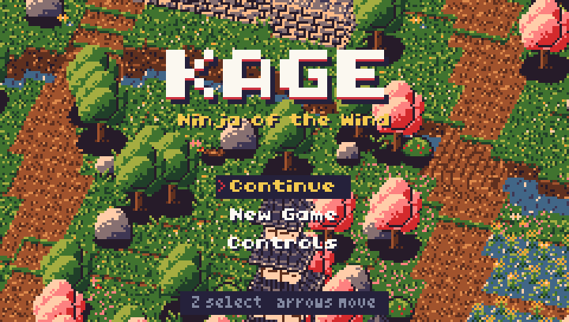
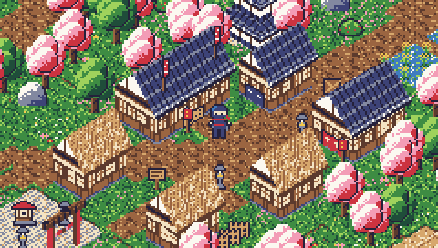
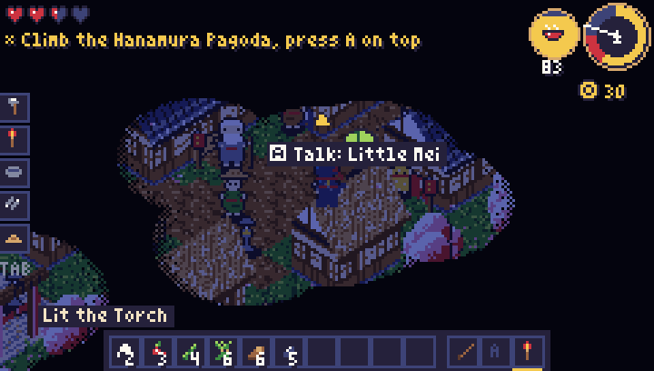
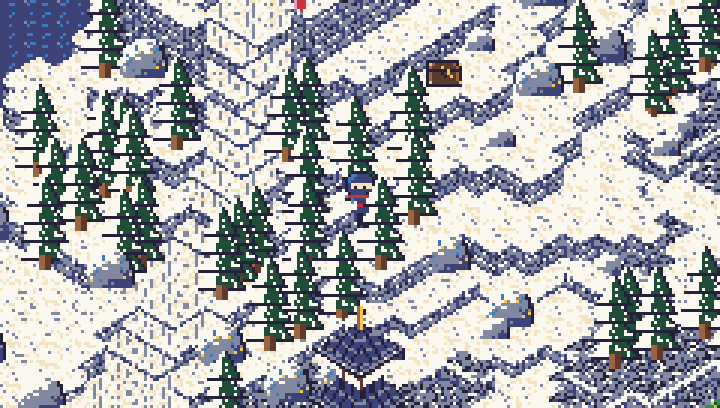
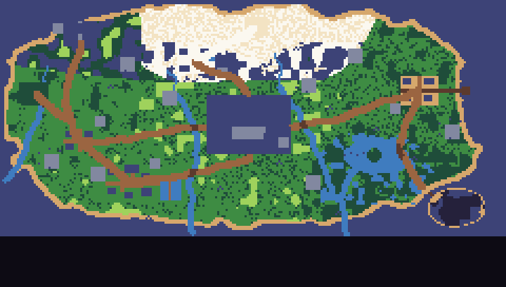
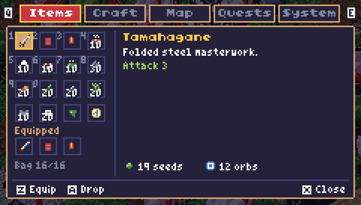
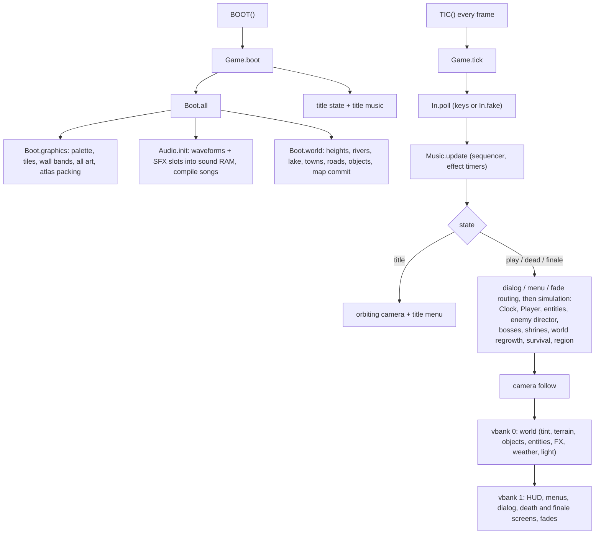

> ▶ **Play in the browser:** https://dandysuper.github.io/kage-ninja-of-the-wind/play/  
> 📜 How it was built: [TRANSCRIPTS.md](TRANSCRIPTS.md)

# KAGE — Ninja of the Wind

A 2.5D open-world ninja RPG for the **TIC-80** fantasy console: explore a
feudal-Japan island with a rotatable isometric camera, climb anything, glide on
a kite, survive the night like in *Don't Starve*, and recover the Three Sacred
Treasures before facing the Oni King, *Breath of the Wild* style.

| | |
| --- | --- |
|  |  |
|  |  |
|  |  |

- **Platform:** TIC-80 Pro 1.3.1, Lua 5.3, 240×136 screen at 60 fps
- **Cart:** `kage.lua`, about 345 KB of Lua built from 32 modules in `src/`
- **Assets:** none. Every sprite, texture, 3D model, sound and song is generated by code at boot.

## Contents

1. [Playing](#playing)
2. [Controls](#controls)
3. [The game](#the-game)
4. [Project layout](#project-layout)
5. [Source modules](#source-modules)
6. [Architecture](#architecture)
7. [Audio](#audio)
8. [Save data](#save-data)
9. [Building and testing](#building-and-testing)
10. [Conventions and gotchas](#conventions-and-gotchas)

---

## Playing

Open `kage.lua` in TIC-80 Pro, or start it from a terminal:

```sh
"/Applications/TIC-80 Pro.app/Contents/MacOS/tic80" kage.lua
```

`kage.lua` is a build product. After editing anything in `src/`, rebuild it with
`sh tools/build.sh` (see [Building and testing](#building-and-testing)).

The title screen offers Continue, New Game and Controls. A new game starts in
Hanamura with Sensei Hayate's first lesson. Music and sound volume are in the
pause menu under **System**, and are stored separately from the save game.

## Controls

| Key | Action |
| --- | --- |
| Arrows | Move (relative to the camera) |
| Shift or C | Sprint (uses stamina) |
| X | Jump. Hold in the air to glide (after quest 1). Second press: double jump (after the Jewel). While climbing: leap up. In water: leap out. In menus: back |
| Z | Katana combo. Chop, mine or cut what you face. In the air: plunge attack. In menus: confirm |
| A | Talk, pick up, open, cook, pray. Items tab: drop |
| S | Throw a shuriken. Craft tab: next category |
| Q / E | Rotate the camera 45°. In menus: switch tab |
| Tab or I | Bag and crafting |
| M / J | Map / quest journal |
| 1–0 | Use a hotbar slot (eat, equip, light, place) |
| Enter / Space | Confirm |

Push into any cliff, wall or building to climb it. Climbing, sprinting,
gliding and swimming drain the stamina wheel shown next to the ninja.

---

## The game

### Core loop

You explore, gather (grass by hand; bamboo, trees and rocks with Z), craft
tools and light, cook food and survive the day/night cycle. Climbing pagodas
reveals the map and unlocks fast travel. Quests lead to four boss fights, and
spirit shrines and kodama make you stronger.

### Survival

| System | Rule |
| --- | --- |
| Day/night | A full day lasts 6 minutes. Dusk starts at 58% of the day, night at 72%, dawn at 96%. Rain, snow, petals and fireflies depend on the region. |
| Darkness | At night, outside any light, "the Yami" whispers after 1 s and attacks after 4 s. Torches, lanterns, campfires and the Yata Mirror keep you safe. |
| Hunger | Drops by 1 every 5 s. At 0 you lose a quarter heart every 4 s. Raw meat and mushrooms hurt; cook them. |
| Cold | High on Mount Fuyu you freeze without the Fur Cloak, warm food or a fire. |
| Health | Hearts in quarters, 4 to start, up to 12. Falls of more than 46 units hurt. |
| Death | You wake at your last inn or shrine and lose a quarter of your ryo. |
| Rest | Inns (15–25 ryo) sleep to dawn, heal fully and save. A bedroll heals half. |

### World

The map is 240 × 112 cells (each cell is 8 × 8 world units) holding one
continent and the island of Onigashima. It is generated deterministically at
boot in about 230 ms.

| Region | Biome | Notes |
| --- | --- | --- |
| Sakura Vale | Blossom forest | Start: Hanamura, the dojo, rice paddies |
| Whispering Bamboo | Bamboo | Takemura, Ponta the tanuki, the Bamboo Pagoda, the Spider Lair, where Tama the cat is lost |
| Kyo Plains | Plains | Kyo with its castle and walls, the Kannon statue |
| Mount Fuyu | Snow | Yukimura and its onsen, the Tengu Lord's summit, cold |
| Haunted Wood | Haunted | Kurodera temple and pagoda, dead maples and graves, kitsune at night |
| Minato Coast | Coast | Minato port and its Lighthouse Pagoda |
| Kappa Marsh | Marsh | Kappa, the Great Lake and Orochi |
| Onigashima | Volcanic island | Shuten-doji, reached over the sealed bridge |

Landmarks: 5 towns with 4 inns, 6 climbable pagodas, 8 spirit shrines (4
combat trials and 4 pillar climbs), 19 hidden kodama, 15 chests, 14 enemy
camps, rivers with bridges, roads and the Great Lake. 30 townsfolk, quest
givers, shopkeepers and guards live in the towns; quest NPCs show "!" (quest to
offer) and "?" (turn-in) markers.

### Progression

| Source | Reward |
| --- | --- |
| Pagodas: climb one and press A on top | The surrounding map is revealed, fast travel unlocks, the game saves |
| Spirit shrines | A Spirit Orb. 4 orbs at the Kannon statue in Kyo buy a heart container or a stamina vessel (+25) |
| Kodama seeds | 3 seeds given to Ponta the tanuki add 2 bag slots (10 slots at start, up to 16) |
| Main quests | Kite glider (glide), Magatama Jewel (double jump), Yata Mirror (the dark can't hurt you), Kusanagi sword |
| Shops and chests | Better blades (Katana, Tamahagane), armor, lanterns, cooking pots |

### Quests (15)

**Main story.**
1. The Way of the Shinobi: craft a torch, survey the Hanamura Pagoda, return to Sensei Hayate.
2. Shadow over Kyo: Lady Sayo explains the stolen treasures.
3. The Jewel in the Web: defeat Jorogumo.
4. The Mirror on the Peak: defeat the Tengu Lord.
5. The Sword in the Serpent: defeat Orochi.
6. Onigashima: bring the treasures to Lady Sayo, then defeat Shuten-doji and see the finale.

**Side quests.**
- Rice for the Village (farmer)
- Where is Tama? (Little Mei)
- Bandit Bounty (Captain Ishida)
- Leaves for Tea (Tea Master Rikyu)
- Warm Pelts (Tailor Kiku)
- Kappa Trouble (Fisher Isamu)
- Special Delivery (merchant)
- Threads of Steel (Woodcutter Taro)
- Restless Spirits (Abbot Genshin)

Quest steps are `craft`, `tower`, `talk`, `have`, `kill`, `boss` and `find`.
Game events (a kill, an item, a tower, a boss) advance them.

### Bosses

| Boss | Arena | HP | Style |
| --- | --- | --- | --- |
| Jorogumo, Spider Queen | Spider Lair | 40 | Leaps, web fans, spiderlings |
| Sojobo, Tengu Lord | Mount Fuyu summit | 46 | Flies, feather volleys, dives, gusts, summons tengu |
| Yamata no Orochi | The Great Lake | 64 | Heads surface near you to bite or spit fire |
| Shuten-doji, Oni King | Onigashima | 90 | Smashes, fire rings, charges, summons oni |

A boss appears when you enter its arena with the right quest active, and the
fight resets if you leave or fall.

### Enemies

Bandit, Ronin, Wolf, Snow Wolf, Boar, Kappa, Tengu (ranged), Yurei and Onibi
(night only), Oni (heavy), Spider and Kitsune (teleports).

- **Camps.** Fourteen camps refill once a day when cleared and you are away.
- **Director.** Outside towns, a spawn director adds roaming foes 120–170 units away. By day it adds up to 3 animals chosen per biome. At night it adds up to 5 yokai: yurei and onibi, plus kitsune in the Haunted Wood.

### Items, crafting and cooking

| Kind | Examples |
| --- | --- |
| Weapons | Bokken (start), Katana, Tamahagane, Kusanagi |
| Armor | Straw Kasa, Bamboo Armor, Fur Cloak, Samurai Armor |
| Light | Torch, Paper Lantern |
| Tools | Hatchet (chops faster), Pickaxe (needed for rocks and ore) |
| Placeable | Campfire Kit, Cooking Pot, Straw Bedroll |
| Food | Onigiri, sushi, nabe stew, dango, mochi, green tea, berries, grilled meat/fish/mushrooms, … |
| Resources | Wood, bamboo, grass, flint, stone, iron, gold, pelts, silk, feathers, embers, essence, … |

- **Crafting.** The crafting menu has five tabs:
  - **Tools:** Hatchet, Pickaxe, Rope, Washi Paper
  - **Light:** Torch, Campfire Kit, Paper Lantern
  - **Survival:** Bandage, Straw Bedroll, Cooking Pot
  - **Combat:** Shuriken, Bamboo Armor
  - **Dress:** Straw Kasa, Fur Cloak
- **Cooking.** A campfire cooks single ingredients. A cooking pot combines them: sushi, nabe stew, sakura dango, mochi and green tea.
- **Shops.** There are six: Hanamura, the Kyo smith, the Kyo tea house, Minato, Yukimura and Takemura.
- **Chopping.** Any weapon chops wood, and a hatchet makes it faster. Trees lean further with every hit, then topple and leave a stump. Harvested plants regrow after a few in-game days.

---

## Project layout

```
ninja game/
├── kage.lua            the playable cart (built, do not edit by hand)
├── README.md           this file
├── HANDOFF.md          engineering handoff: verified facts, status, TODO list
├── src/                game source, 32 Lua modules (concatenated into kage.lua)
├── tests/              headless test drivers + the shared harness
├── tools/              build / test / screenshot / audio-render scripts
├── docs/screenshots/   images used by this README
├── build/              generated: test carts, logs, screenshots, audio previews
└── legacy/             the original side-scrolling version (self-contained)
```

---

## Source modules

`tools/build.sh` concatenates `src/*.lua` in **filename order** into one Lua
chunk, skipping files that start with `_`. The number prefix sets the order,
and each band of numbers is a layer:

| File | Responsibility |
| --- | --- |
| **00–08 Foundation and art** | |
| `00_head.lua` | Cart metadata (title, author, `script: lua`) and the controls summary |
| `01_core.lua` | Math shortcuts, hash/noise/fbm, `In` (input actions, `In.fake` for tests), `Frame` |
| `02_pal.lua` | The 16-colour palette (`C_*` names), day/night tint of bank 0, palette maps (`Pal.remap/solid/reset`) |
| `03_gfx.lua` | Sprite sheet access, skyline atlas packer (`Gfx.add` → `Gfx.flush` → `SPR[name]`), 8×8 icons, `blit` |
| `04_tiles.lua` | Ground tiles (`T`), cliff/wall texture bands (`BAND`), procedural tile painters, animated water/lava |
| `05_art_chars.lua` | The ninja: side/front/back frames, slashes, jump, glide, climb, swim |
| `06_art_world.lua` | Trees, rocks, plants, props, effects, wall decals |
| `07_art_items.lua` | 8×8 item, key and UI icons |
| `08_art_mobs.lua` | NPCs, enemies and bosses |
| **10–13 World generation** | |
| `10_world.lua` | `REG` regions, heights, rivers, the lake, ground tiles, roads; per-cell world arrays |
| `11_build.lua` | Materials, buildings with gable/hip roofs, pagodas, the castle, torii (3D models) |
| `12_objects.lua` | `OBJ` object table (trees, rocks, plants, props) and biome scatter |
| `13_towns.lua` | Towns, temple, boss arenas, shrines, kodama, chests, camps, signs, `POI`, NPC spawn list |
| **20 Rendering** | |
| `20_render.lua` | Camera and `proj()`, terrain chunk meshing and cache, models, billboards (`Render.bill`, `Render.billRot`), ground decals, `Render.world` |
| **30 Boot** | |
| `30_boot.lua` | `Boot.all`: palette and art, then `Audio.init`, then world generation |
| **35–48 Gameplay systems** | |
| `35_items.lua` | `ITEM`, inventory (`Inv`), crafting (`RECIPES`, `TABS`), pot recipes (`POT`), `SHOPS` |
| `36_interact.lua` | `World.hit` (harvest, chop), `World.fell` (falling trees), `World.interact` (A), regrowth, campfires |
| `40_ent.lua` | Entity list `ENTS`, `groundAt`, collision (`Ent.resolve`), physics, facing, shadows |
| `41_player.lua` | The ninja controller: movement, jump/glide/climb/swim, combat, interaction, drawing |
| `42_enemy.lua` | `ETYPE`, enemy AI, camps and the spawn director |
| `43_npc.lua` | NPC kinds, wandering, talking, shops, inns, Ponta the tanuki, Tama the cat |
| `44_quest.lua` | `QUESTS` data, quest state machine, NPC markers, compass target, pagoda survey |
| `45_clock.lua` | Day/night clock, tint keys, hunger/cold/darkness, light sources and the darkness overlay |
| `46_fx.lua` | Particles, slash arcs, floating text, screen shake, hit-stop |
| `47_proj.lua` | Projectiles (shuriken, arrows, feathers, fire, webs) and item drops |
| `48_boss.lua` | The four bosses, the sealed bridge, spirit shrines and trials, the Kannon statue |
| **50–51 Interface** | |
| `50_ui.lua` | Text helpers, panels, toasts, banners, region titles, the dialog box, the HUD |
| `51_menu.lua` | Pause menu (Items, Craft, Map, Quests, System), cooking, shops, world map and fast travel |
| **60–61 Services** | |
| `60_audio.lua` | Waveforms, instruments, effects and songs as data; the music sequencer; `Sfx`, `Music` |
| `61_save.lua` | Save/load in persistent memory (`pmem`) |
| **70–80 Game loop** | |
| `70_game.lua` | Game states, the per-frame pipeline, camera, weather, sleeping, fast travel, death |
| `80_main.lua` | TIC-80 entry points `BOOT()` and `TIC()`; must stay last |

---

## Architecture

### Boot and frame pipeline



**Game states.** `title` leads to `play` (New Game or Continue). `play` can
switch to `dead` (you wake at an inn or shrine) and to `finale` (after
Shuten-doji, then back to free roaming). On top of `play` there are overlays:
`Dialog.active` and `Menu.cur` pause the simulation, and `Game.fade` covers
sleep and fast travel.

### Rendering (2.5D)

- **Two video banks.**
  - **vbank 0 (the world):** palette tinted for day and night, and dimmed while a menu is open.
  - **vbank 1 (the overlay):** keeps true colours for the HUD and menus. Colour 0 is transparent on this bank.
- **Real 3D scene with a z-buffer.** The camera is orthographic and isometric, starting at a 45° yaw, and Q/E rotate it smoothly in 45° steps. Everything is drawn as depth-tested textured triangles (`ttri` with z), so there is no painter's sorting.
- **Terrain.** A heightfield of 8 × 8 cells with cliffs. Each 8 × 8-cell chunk is meshed lazily into greedy top rectangles and side faces, and the result is cached.
- **Objects and characters.**
  - Buildings, pagodas, the castle and torii are polygon models.
  - Characters, trees and props are billboards. Their tops get the depth of a vertical object, so cliffs hide them correctly.
  - The player is drawn twice, which gives an x-ray silhouette when something hides him.
- **Light.** At night the world goes black outside light sources, with dithered rims, Don't Starve style.

### World data

Each cell `i = y*240 + x + 1` has parallel arrays:

| Array | Contents |
| --- | --- |
| `WH` | Height (water −4, drawn at −3) |
| `WT` | Ground tile |
| `WO` | Object id (`OBJ`) |
| `WF` | Flags: road, town, roof, model, bridge, no-spawn, water, shallow, hazard |
| `WR` | Region |
| `WM` | Wall material |
| `WB` | Building id |

Map rows 112–135 are not part of the world: they store the cliff and wall
textures that side faces sample.

### Entities

`ENTS` holds every live entity, each with optional `update` and `draw`
callbacks. Kinds are `player`, `enemy` (bosses included), `npc`, `proj`, `drop`
and `fx` (short effects such as a falling tree).

- `groundAt` gives the height under a point: the cell, a sloped roof, or the top of an object cylinder.
- `Ent.resolve` pushes bodies out of cells taller than they can step onto, and out of object cylinders.
- `Ent.physics` applies velocity, collision, gravity and ground snapping.

### Main global tables

| Area | Tables |
| --- | --- |
| Player and control | `P` (the player), `In` (input), `Cam` (camera) |
| Game state | `Game` (state machine), `Clock` (time, weather), `Boss`, `Shrine` |
| World | `World` (hits, chopping, regrowth, chests, kodama), `OBJ` (object types), `REG` / `POI` / `TOWNS` / `TOWERS` / `SHRINES` / `KODAMA` |
| Items and quests | `ITEM`, `Inv`, `QUESTS`, `QS` (quest progress) |
| Interface | `UI`, `Dialog`, `Menu`, `MapUI` |
| Rendering and effects | `SPR` (sprite rects), `Render`, `FX` |
| Audio and saves | `Sfx`, `Music`, `Audio`, `Save` |

---

## Audio

Everything is synthesized from data in `src/60_audio.lua`; the cart has no
binary sound sections.

- **Generation.** `Audio.init` writes 16 waveforms (koto, shakuhachi, shamisen, fue, bell, drum, noise, …) and the instruments and effects into sound RAM.
- **Channels.** Music plays on channels 0–2 through a small step sequencer. Effects play on channel 3 with priorities, so they never cut the melody.
- **Music.** Seven seamless loops:

  | Track | When it plays |
  | --- | --- |
  | `field` | Day, most regions |
  | `night` | Night everywhere, and the Haunted Wood |
  | `snow` | Mount Fuyu |
  | `town` | Inside towns |
  | `oni` | Onigashima |
  | `boss` | Boss fights and shrine trials |
  | `title` | Title screen and finale |

  The main theme is in the Yo scale. The night and title versions turn it dark with the In scale.
- **Effects.** 40 sound effects plus 3 jingles (quest complete, pagoda survey, victory). Jingles briefly pause the music.
- **API.**
  - `Sfx.play(name)` plays an effect.
  - `Music.play(track)` switches tracks.
  - `Music.region()` picks the right track for where you are.
  - `Audio.setLevels(music, sfx)` sets the volumes, stored in pmem slot 255.

---

## Save data

Saves use TIC-80 persistent memory (`pmem`, 256 × 32-bit). The game autosaves
at dawn, at inns, at shrines, when you survey a pagoda and when you complete a
quest. Harvested objects are not saved; they regrow.

| Slots | Contents |
| --- | --- |
| 0 | Magic number `0x4B470002` |
| 1–19 | Position, health, stamina, hunger, ryo, day, time, orbs, seeds, bag size, abilities, equipment, light fuel, respawn point |
| 20–35 | Inventory (`itemIndex * 1000 + count`) |
| 36–51 | Quests (`state + step * 4 + count * 256`) |
| 56–62 | Bitmasks for towers, shrines, bosses, kodama and chests, plus the tracked quest |
| 70–122 | Map fog of war |
| 255 | Music and sound volume (separate from the save game) |

---

## Building and testing

```sh
cd "/Users/danb/Documents/ninja game"
sh tools/build.sh                      # src/*.lua -> kage.lua
sh tools/test.sh tests/t_smoke.lua     # run one test headless
for t in t_smoke t_audio t_climb t_title t_quests t_reach t_world shot_ui; do
  sh tools/test.sh tests/$t.lua 300    # the full suite (~1 minute)
done
```

| Tool | Purpose |
| --- | --- |
| `tools/build.sh` | Builds the cart. The playable cart ends with a `<PALETTE>` section. `--code-only` leaves it out for test carts. |
| `tools/test.sh` | Builds `build/<test>.cart.lua` (game + `tests/_harness.lua` + the driver) and runs TIC-80 headless (`--cli`) with a watchdog. Fails on any Lua error or `FAIL` line. |
| `tools/frames.py` | Turns framebuffer dumps from a test log into PNGs in `build/shots/` |
| `tools/audio.py` | Re-synthesizes the sound registers logged by `t_audio` with TIC-80's algorithm, writing MP3 previews and piano-roll images to `build/audio/` |

| Test | What it covers |
| --- | --- |
| `t_smoke` | New game, scripted movement, combat, every menu tab, crafting, climbing, night, then about 2,700 frames of random input with random teleports |
| `t_title` | The real start-up flow: title screen, controls panel, New Game, intro dialog, music change |
| `t_quests` | The whole main story (4 bosses and the finale) and every side quest, including full-bag and missing-item edge cases |
| `t_reach` | Every kodama and spire orb can be reached and collected with base stamina |
| `t_world` | Leaving water (swimming out, X leap), chopping trees and bamboo with and without a hatchet |
| `t_climb` | Climb the Hanamura pagoda and stay on top |
| `t_audio` | Audio data checks, region → music mapping, priorities, volume levels; logs sound registers for `tools/audio.py` |
| `shot_ui` | UI lint: renders every screen with worst-case content and fails on text that leaves the screen, overlaps other text or crosses a border |
| `shot_world`, `shot_sheet` | Camera views, the world map and art contact sheets |

Test helpers (`tests/_harness.lua`):
- `Test.ok(condition, message)` records a check.
- `Test.log(text)` writes a log line.
- `Test.dump(tag)` saves a screenshot.
- `Test.finish()` ends the run.
- Drivers inject input with `In.fake = { up = true, atk = true, ... }`.

---

## Conventions and gotchas

- **One Lua chunk.** A top-level `local` in one module is visible to every later module and shadows globals with the same name. The chunk is close to Lua's 200-local limit, so modules expose tables instead. New modules wrap their internals (for example `;(function() ... end)()` in `60_audio.lua`).
- **Art strings.** Art is written as text: a hex digit is a palette colour, `.` is transparent, rows are separated by newlines or `|`. Icons are exactly 8 × 8. The sprite atlas is nearly full, so prefer palette-mapped variants to new sprites.
- **Overlay colour 0.** Never use colour 0 for visible pixels on vbank 1; it is transparent there.
- **UI layout.** Menu panels keep a key-hint footer row. Cut long text with `Menu.fit` and scroll long lists with `Menu.scroll`. Run `shot_ui` after any UI change.
- **Section markers.** A line starting with `-- <` ends the code section of a text cart, so no source line may start that way. The `<PALETTE>` section must stay last.
- **No explicit nils.** An explicit `nil` passed to a TIC-80 API call counts as an argument (`print(s, x, y, c, nil, nil, nil)` prints at scale 0). Wrappers must forward `...`.
- **No `--volume` flag.** Never pass `--volume` to `tic80`: TIC-80 saves the overridden volume into its own settings on exit and stays muted.
- **Integer notes.** `sfx()` needs integer notes; a float raises "invalid note".

The full engineering handoff (verified emulator behaviour, the projection
maths, status and the TODO list) is in [HANDOFF.md](HANDOFF.md). The original
side-scrolling version of the game lives untouched in `legacy/`.

---

*KAGE — Ninja of the Wind* by dandimo · MIT License
